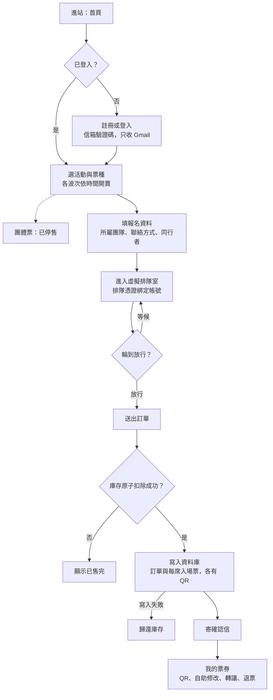
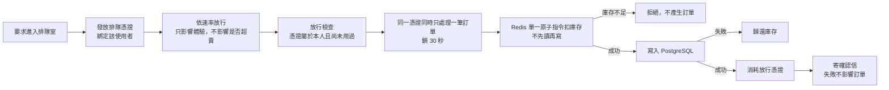
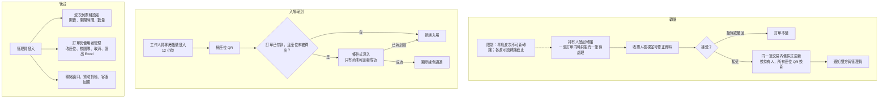

# 3. 專案的框架及流程圖

## 系統組成

| 部分 | 負責什麼 | 為什麼這樣分 |
|---|---|---|
| 前端（Vercel） | 首頁、報名、排隊、我的票券、後台、報到介面 | 與後端分開部署，主分支更新後自動上線 |
| 後端 API（Railway） | 帳號、訂單、轉讓、報到、後台、贊助、客服小幫手 | 所有規則集中在後端，前端無法繞過 |
| 庫存與計數（Redis） | 可售數量、排隊憑證、各種計數與鎖 | 搶票瞬間需要原子操作；資料庫只記已經成功的結果 |
| 資料庫（PostgreSQL） | 使用者、訂單、座位票、轉讓、修改紀錄、贊助、聯絡窗口 | 長期保存；防重複由唯一索引把關 |
| 虛擬排隊室 | 控制進入下單流程的速度 | 只負責速度與體驗，不負責防超賣，所以放行速度可以放心調整 |
| 轉讓 | 兩步驟轉讓：收票人接受前，票券不移動；每一波可設轉讓截止時間，截止後不能發起新轉讓，也不能接受已發出的邀請 | 不會出現一張票兩個主人；截止後票券留在原持有人名下 |
| 入場票與報到 | 每席一張 QR，報到時用條件式寫入；工作人員以專屬帳號登入、用手機掃描；有各團隊的報到名單與人數統計 | 同一張 QR 只能報到一次；轉讓後舊 QR 失效 |
| 修改紀錄 | 每次訂單變更都記一筆修改前後的內容 | 被覆寫的資料不會遺失；紀錄寫入失敗不影響已完成的操作 |
| 客服小幫手 | 回答系統操作問題 | 只根據 FAQ，不拿使用者資料、不執行動作，答不出來轉人工 |
| 防濫用 | 速率限制、登入失敗計數、一個信箱一個帳號 | 先計次再驗證，避免大量同時請求繞過限制 |
| 個資保護 | 密碼以雜湊方式儲存；網站與 API 全程使用加密連線（HTTPS）；其他使用者看不到彼此的聯絡資料；使用者可以申請刪除帳號，管理員可在後台刪除使用者與其訂單 | 系統裡有很多參與者的 Email 與真實姓名 |

付款說明：訂單成立即為已付款狀態，款項在系統外結算，系統內沒有退款功能。其他付款細節待確認。

> 「為什麼這樣分」欄的依據是專案文件與程式註解。

## 流程圖

### 購票者：從進站到拿到票

### 排隊與防超賣

### 轉讓、報到、後台

